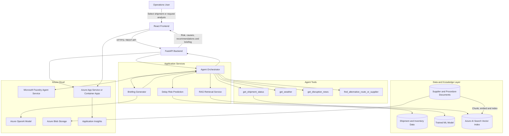

# Supply-Chain Disruption Agent

An AI-powered logistics application that monitors shipment and inventory signals, predicts disruption risks, investigates likely causes, recommends alternatives, and generates a concise operations briefing.

## The Problem

A late shipment can cascade into stockouts and operational delays, but the risk is often identified too late. This project provides an early-warning and decision-support system for logistics teams.

## What the System Does

- Combines shipment, inventory, weather, supplier, and news signals.
- Predicts the probability and severity of shipment delays.
- Investigates likely causes through agent tool-calling.
- Retrieves supplier and operating-procedure knowledge through RAG.
- Recommends alternative routes or suppliers.
- Generates a disruption briefing for the operations team.
- Presents results through a web dashboard deployed on Azure.

## Architecture



## Architecture Flow

1. The operations user selects a shipment or submits a shipment ID through the React dashboard.
2. The frontend sends the request to the FastAPI backend.
3. The agent orchestrator calls the prediction service and relevant operational tools.
4. The machine-learning model returns a delay probability and risk level.
5. Tool calls collect shipment, weather, news, route, and supplier information.
6. The RAG service retrieves relevant supplier records and operating procedures.
7. The generative model produces a grounded disruption briefing.
8. The API returns the risk score, contributing factors, recommendations, evidence, and briefing to the dashboard.

## Tech Stack

| Layer | Technology |
|---|---|
| Frontend | React, JavaScript or TypeScript, HTML, CSS |
| API | Python, FastAPI, Uvicorn, Pydantic |
| Agent Orchestration | Microsoft Foundry Agent Service, custom Python tools, OpenAPI tool-calling |
| Machine Learning | pandas, NumPy, scikit-learn, joblib |
| RAG and Retrieval | Azure AI Search, vector search, document chunking and embeddings |
| Generative AI | Azure OpenAI model for investigation summaries and operations briefings |
| Data Sources | Shipment, inventory, supplier, weather, route, and public disruption data |
| Operational Database | Azure SQL Database or PostgreSQL |
| Document Storage | Azure Blob Storage |
| Deployment | Azure App Service or Azure Container Apps, Docker |
| Monitoring | Azure Monitor, Application Insights, structured application logs |
| Testing | pytest, FastAPI TestClient, Postman, React Testing Library |
| Collaboration | Git, GitHub, GitHub Projects, pull requests |
| Security | Microsoft Entra ID, managed identities, Azure Key Vault, role-based access control |

## Core AI Components

### 1. Delay-Risk Prediction

The machine-learning service uses shipment and operational features to return:

- Delay probability
- Risk level: Low, Medium, or High
- Important contributing factors

### 2. Agent Tool-Calling

The agent coordinates the investigation by calling tools such as:

```python
get_shipment_status(shipment_id)
get_weather(location, date)
get_disruption_news(route_or_port)
find_alternative_route(shipment_id)
find_alternative_supplier(item_id)
```

### 3. Retrieval-Augmented Generation

The RAG pipeline indexes approved supplier information and operating procedures. Retrieved evidence is supplied to the model so the generated recommendation is based on project knowledge rather than unsupported assumptions.

### 4. Operations Briefing

The generated briefing should contain:

- Shipment identifier
- Risk level and delay probability
- Likely causes
- Supporting evidence
- Recommended action
- Alternative route or supplier, when available
- Confidence or limitations

## Example API Response

```json
{
  "shipment_id": "SHP-1042",
  "risk_level": "High",
  "delay_probability": 0.81,
  "likely_causes": [
    "Adverse weather near the destination port",
    "Route congestion"
  ],
  "recommended_actions": [
    "Review the proposed alternative route",
    "Notify the inventory planning team"
  ],
  "sources": [
    "Shipment status record",
    "Weather tool response",
    "Approved disruption procedure"
  ],
  "briefing": "Shipment SHP-1042 has a high risk of arriving late. The main contributing signals are adverse weather and route congestion. Operations should review the proposed alternative route and notify inventory planning."
}
```

## Suggested Repository Structure

```text
supply-chain-disruption-agent/
├── frontend/                 # React web application
├── backend/
│   ├── api/                  # FastAPI routes and schemas
│   ├── agents/               # Agent instructions and orchestration
│   ├── tools/                # Shipment, weather, news and alternative tools
│   ├── ml/                   # Training, inference and model artifacts
│   ├── rag/                  # Ingestion, chunking, indexing and retrieval
│   └── tests/                # Backend and integration tests
├── data/
│   ├── raw/                  # Original project datasets
│   ├── processed/            # Cleaned and engineered data
│   └── knowledge/            # Supplier and procedure documents
├── notebooks/                # Exploration and model experiments
├── infrastructure/           # Azure and deployment configuration
├── docs/                     # Architecture, decisions and demo material
├── .env.example
├── docker-compose.yml
├── requirements.txt
└── README.md
```

## Team Workstreams

| Workstream | Owner | Main Responsibility |
|---|---|---|
| Leadership and Integration | Frederick | Scope, coordination, integration, Azure deployment and final demonstration |
| Data and Machine Learning | Olawumi | Data preparation, feature engineering, model training and evaluation |
| Backend and Agent Tools | Tosin | FastAPI, model integration, tool functions and error handling |
| RAG and Generative AI | Janet | Knowledge ingestion, retrieval, prompts and briefing generation |
| Frontend and Quality Assurance | Joy | React dashboard, user workflow, testing and demo scenarios |

Workstream ownership supports accountability, but every team member should understand the complete end-to-end solution.

## Minimum Viable Product

The first working version should allow a user to:

1. Select or enter a shipment.
2. Receive a delay probability and risk level.
3. View likely disruption factors.
4. Trigger at least two agent tools.
5. Retrieve a relevant supplier or procedure document.
6. Receive an actionable recommendation.
7. Generate a concise operations briefing.

## Responsible AI and Safety

- Show the evidence used to support recommendations.
- Keep prediction results separate from generated explanations.
- Label simulated or mock data clearly.
- Do not let the language model invent shipment facts, suppliers, or routes.
- Apply human review before operational decisions are executed.
- Log tool calls, model outputs, failures, and user-visible recommendations.
- Avoid exposing credentials, personal data, or confidential supplier information.

## Project Status

**Current phase:** Planning and architecture design.

Initial priorities:

- Confirm the delay definition and target variable.
- Select the dataset and external data sources.
- Agree on API input and output schemas.
- Build one end-to-end shipment scenario.
- Deploy the stable MVP to Azure before adding optional features.
